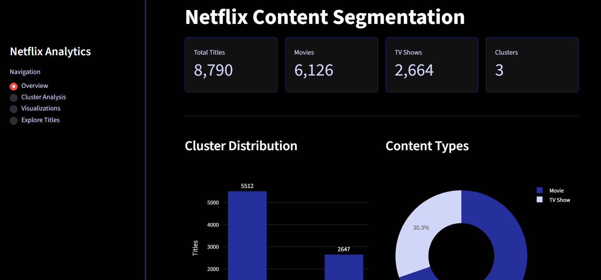
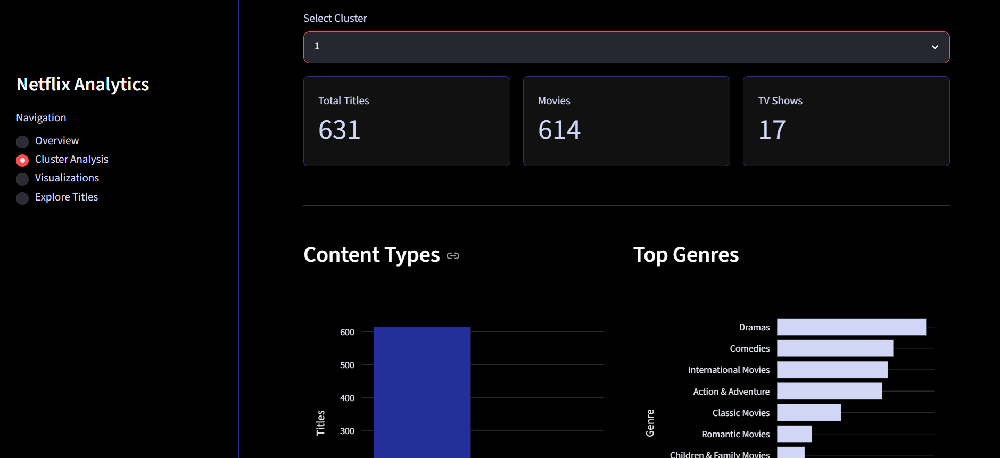
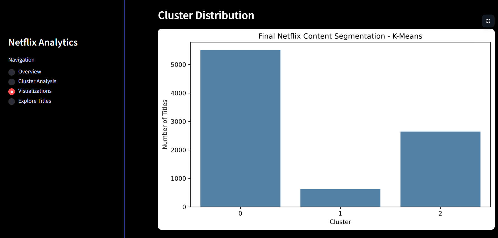
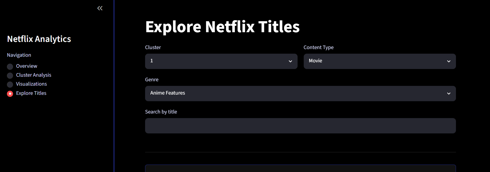

# Netflix Content Segmentation – K-Means Clustering

A machine learning project that groups Netflix movies and TV shows into meaningful content clusters using unsupervised learning techniques.

## About the Project

Netflix Content Segmentation is an unsupervised machine learning project developed using Python and Streamlit. It uses the Netflix Movies and TV Shows dataset to identify patterns and group titles based on their content characteristics.

The project applies K-Means clustering using features such as content type, country, release year, rating, duration and genres.

The results are presented through an interactive dashboard that allows users to explore the clusters and their characteristics.

## Features

- Groups Netflix titles into three clusters using K-Means.
- Analyzes content based on genres, countries, ratings and release years.
- Separates Movies and TV Shows based on their characteristics.
- Visualizes cluster distribution and genre patterns.
- Provides cluster-wise content analysis.
- Allows users to search and filter titles by cluster, content type and genre.
- Interactive dashboard built using Streamlit.

## Machine Learning Approach

### 1. Data Preprocessing

- Loaded and explored the Netflix dataset.
- Examined content types, genres, ratings and release years.
- Extracted movie duration and number of seasons from the duration column.
- Converted genre and country information into numerical features using one-hot encoding.
- Encoded content type and ratings.
- Scaled numerical features using StandardScaler.

### 2. K-Means Clustering

K-Means is an unsupervised machine learning algorithm that groups data points into clusters based on their similarity.

The Elbow Method and Silhouette Score were used to evaluate different cluster counts.

After comparing the results, K=3 was selected for the final model.

### 3. Cluster Analysis

The three clusters were examined using their content types, genres, release years and duration.

The final model produced a Silhouette Score of 0.2876, indicating moderate separation between clusters.

### 4. Visualization

Cluster distribution, genre patterns and content type distribution were visualized to understand the characteristics of each group.

## Technologies Used

| Technology     | Purpose                         |
| -------------- | ------------------------------- |
| Python         | Programming language            |
| Pandas         | Data preprocessing and analysis |
| NumPy          | Numerical operations            |
| Scikit-learn   | Machine learning implementation |
| K-Means        | Content clustering              |
| StandardScaler | Feature scaling                 |
| Matplotlib     | Data visualization              |
| Seaborn        | Statistical visualization       |
| Plotly         | Interactive charts              |
| Streamlit      | Web application development     |
| Joblib         | Saving the trained model        |

## Dataset

The project uses a Netflix Movies and TV Shows dataset containing information about titles, directors, countries, release years, ratings, durations and genres.

The dataset contains 8,790 titles.

## Project Structure

```text
Netflix-Content-Segmentation/
│
├── app.py
├── netflix_segmentation.ipynb
├── Dataset.csv
├── Netflix_Clustered_Data.csv
├── kmeans_model.pkl
├── scaler.pkl
├── numerical_features.pkl
├── feature_columns.pkl
├── requirements.txt
├── README.md
│
└── images/
    ├── overview_page.png
    ├── cluster_analysis.png
    ├── visualisation.png
    ├── explore.png
    ├── final_cluster_distribution.png
    ├── final_content_type_distribution.png
    └── final_genre_heatmap.png
```

## Installation and Execution

### 1. Clone the Repository

```bash
git clone YOUR_GITHUB_REPOSITORY_LINK
```

### 2. Navigate to the Project Folder

```bash
cd Netflix-Content-Segmentation
```

### 3. Create a Virtual Environment

```bash
python -m venv .venv
```

### 4. Activate the Virtual Environment

For Windows:

```powershell
.venv\Scripts\activate
```

### 5. Install Dependencies

```bash
pip install -r requirements.txt
```

### 6. Run the Application

```bash
python -m streamlit run app.py
```

The application will open in your browser.

## Application Preview

### Overview



### Cluster Analysis



### Visualizations



### Explore Titles



---
